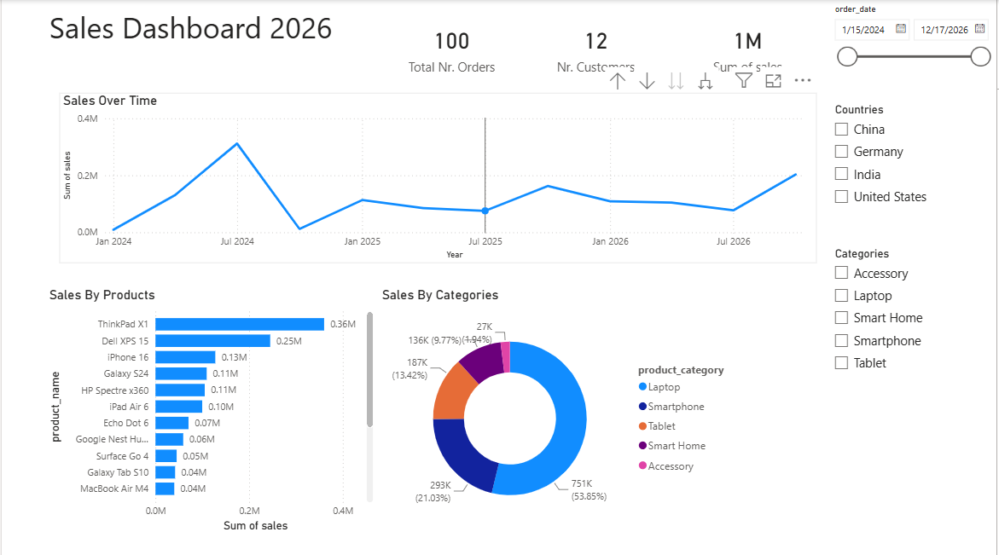
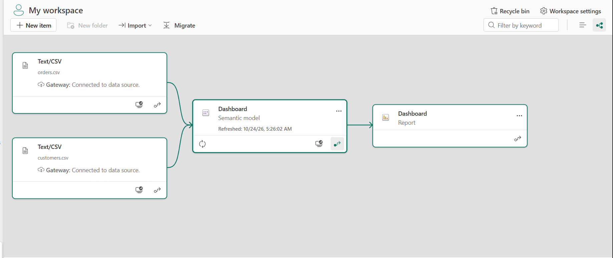

# Sales Dashboard

A sales dashboard built with **Microsoft Power BI** using customer and order data.

## Dashboard Preview

## Project Files

- `Dashboard.pbix` — Power BI report file
- `Data/customers.csv` — Customer data
- `Data/orders.csv` — Order data
- `Sales_Dashboard.png` — Dashboard preview
- `Lineage_View.png` — Power BI lineage view

## Power BI Service

The report was published to the **Power BI Service**. The lineage view below shows the data flow and relationships used in the published report.

## How to Use

1. Download or clone this repository.
2. Open `Dashboard.pbix` with Power BI Desktop.
3. Refresh the data if needed.
4. Publish the report to the Power BI Service to view and share it online.
